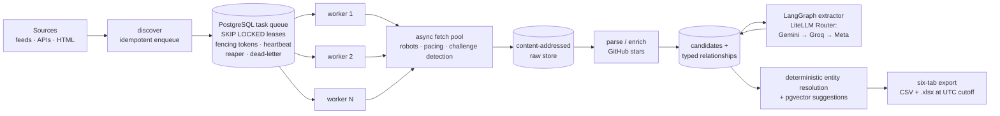

# Frontier Atlas · signal-ingest

**A resumable, horizontally scalable ingestion pipeline for the AI ecosystem: startups, products, research papers, jobs and news.** It has a grounded multi-tier LLM extractor (LangGraph + LiteLLM) and deterministic entity resolution. Every exported row traces back to the source URL it was fetched from.

   

| | |
| --- | --- |
| **Live data (Google Sheet, 6 tabs)** | [Frontier Atlas export](https://docs.google.com/spreadsheets/d/1cNBMMtAjfSz7o9VXdL2qzBd5I7lfzYyLAZNdFOzHi9w/edit?usp=sharing) |
| Architecture (3 pages) | [architecture.pdf](architecture.pdf) · source [docs/architecture-source.md](docs/architecture-source.md) |
| Demo walkthrough | [DEMO.md](DEMO.md) |
| Data contracts | [docs/contracts.md](docs/contracts.md) · sources [docs/sources.md](docs/sources.md) |
| Build log and reviews | [notes/progress.md](notes/progress.md) · [notes/reviews/](notes/reviews) |

---

## Contents
1. [Results](#results)
2. [Architecture](#architecture)
3. [Quick start](#quick-start)
4. [Configuration](#configuration)
5. [Running the pipeline](#running-the-pipeline)
6. [How it works](#how-it-works)
7. [Scaling and operations](#scaling-and-operations)
8. [Anti-bot and JavaScript-heavy sources](#anti-bot-and-javascript-heavy-sources)
9. [Testing and quality gates](#testing-and-quality-gates)
10. [Security and compliance](#security-and-compliance)
11. [Project layout](#project-layout)
12. [Known limitations](#known-limitations)

---

## Results

Live run `a4fee584`, export cutoff **2026-11-23T08:53:50Z** (14:23:50 IST). View the data: **[Google Sheet](https://docs.google.com/spreadsheets/d/1cNBMMtAjfSz7o9VXdL2qzBd5I7lfzYyLAZNdFOzHi9w/edit?usp=sharing)**.

| Tab | Rows | Source and evidence |
| --- | ---: | --- |
| Startups | 1,906 | yc-oss `tags/ai.json` (mirror of the YC company directory) |
| Products | 1,195 | **AgiPicks open dataset** (CC BY 4.0): pricing from its attributed field, owner from the vendor's own homepage (domain-first). **OpenRouter model directory**: owner and pricing from the listing |
| Research Papers | 1,656 | pwc-archive paper→code links (official repos only) + OpenAlex metadata (CC0) + live GitHub REST stars, filled for 100% of rows |
| Jobs | 7 | 24 h fresh at the cutoff. Ashby public posting API (25 AI-company boards); 5 AI job boards monitored. Remote flag is source-backed or LLM-extracted with a verbatim quote |
| News | 15 | 24 h fresh at the cutoff, full article text (Guardian, TechCrunch, MIT News, ScienceDaily) |
| Entity Mapping Log | 3,109 | raw → canonical name, method, decision, evidence URL, embedding suggestions |

Every entity tab carries `schemaVersion`, `recordType`, `source.url`, `collectedAt`, `durableIdentity` and `lineageMode=live`. Entity resolution scores precision 1.00 / recall 1.00 on the gate set (FP 0).

## Architecture



The same code runs on a laptop or on N worker machines; only the infrastructure changes. PostgreSQL holds the queue, leases, observations, candidates, typed relationships (`OWNS`, `IMPLEMENTED_BY`, …), resolution events, quota ledger and embeddings (pgvector HNSW).

## Quick start

### Prerequisites
- Python **3.13**. LiteLLM's clean releases declare `<3.15`.
- [uv](https://docs.astral.sh/uv/)
- PostgreSQL **16** with **pgvector**: either Docker (`pgvector/pgvector:pg16`) or Homebrew `postgresql@16` + pgvector.

### Install
```bash
git clone https://github.com/sumitjadhav1703/Frontier_Atlas.git && cd Frontier_Atlas
uv venv --python 3.13 .venv
VIRTUAL_ENV=.venv uv pip sync --require-hashes requirements.lock   # hash-pinned dependencies
VIRTUAL_ENV=.venv uv pip install --no-deps -e .
cp .env.example .env                                               # add your own keys; never commit .env
```

### Database
Option A, Docker (port 54329; creates `signal_fixture` and `signal_live`):
```bash
docker compose up -d postgres
```

Option B, Homebrew PostgreSQL 16 on :5432:
```bash
brew services start postgresql@16
# pgvector for PG16 (the Homebrew bottle targets PG18/19), built from the official tag:
curl -L -o pgvector.tar.gz https://github.com/pgvector/pgvector/archive/refs/tags/v0.8.7.tar.gz
tar xzf pgvector.tar.gz && make -C pgvector-0.8.7 PG_CONFIG=$(brew --prefix postgresql@16)/bin/pg_config install
for db in signal_fixture signal_live; do psql -d $db -c "CREATE EXTENSION IF NOT EXISTS vector"; done
# then point SIGNAL_INGEST_DSN_FIXTURE / _LIVE at 127.0.0.1:5432 in .env
```

Apply the migrations (`migrations/001…009`):
```bash
.venv/bin/signal-ingest init-db                  # fixture database
.venv/bin/signal-ingest --mode live init-db      # live database
```

### Smoke test (offline, about 40 s)
```bash
SIGNAL_INGEST_MODE=fixture SIGNAL_INGEST_NETWORK_GUARD=1 .venv/bin/python -m pytest -q tests/gates
```

## Configuration

All settings are environment variables (prefix `SIGNAL_INGEST_`) or entries in `.env`. Keys are read only at runtime and are never logged.

| Variable | Default | Purpose |
| --- | --- | --- |
| `SIGNAL_INGEST_MODE` | `fixture` | `fixture` (offline, labelled fixtures) or `live` |
| `SIGNAL_INGEST_NETWORK_GUARD` | `1` | blocks non-loopback sockets; set `0` only for live stages |
| `SIGNAL_INGEST_DSN_FIXTURE` / `_LIVE` | `…127.0.0.1:54329/signal_{fixture,live}` | separate databases per mode |
| `SIGNAL_INGEST_RAW_ROOT_FIXTURE` / `_LIVE` | `var/{fixture,live}/raw` | content-addressed raw store. **Use one absolute shared mount for multi-machine workers** |
| `SIGNAL_INGEST_EXPORT_ROOT_FIXTURE` / `_LIVE` | `var/{fixture,live}/exports` | export snapshots |
| `SIGNAL_INGEST_ORIGIN_CONCURRENCY` | `2` | concurrent requests per site, per worker process |
| `SIGNAL_INGEST_ORIGIN_MIN_INTERVAL_S` | `0.05` | minimum spacing per site, per worker process |
| `GEMINI_API_KEY`, `GROQ_API_KEY` | — | free LLM tiers |
| `MODEL_API_KEY` | — | Meta Model API tier (billed, capped) |
| `OLLAMA_HOST` | `http://127.0.0.1:11434` | optional local tier |
| `GITHUB_TOKEN` | — | GitHub REST at 5,000 req/h for star counts |

LLM tiers, model IDs, per-tier limits, daily quotas and the billed-spend cap live in [`config/providers.yaml`](config/providers.yaml). Sources, with their access URLs, robots/policy notes and status, live in [`config/sources/*.yaml`](config/sources).

## Running the pipeline

### Offline replay (no network)
```bash
RUN=$(signal-ingest --mode fixture crawl --source bulk.yc | python -c 'import json,sys; print(json.load(sys.stdin)["run_id"])')
signal-ingest --mode fixture work --stage any --run "$RUN" --concurrency 4 --drain
signal-ingest --mode fixture export --run "$RUN" --as-of 2026-11-21T12:00:00Z
```

### Live acquisition
`scripts/b8_live_run.sh` runs the whole sequence; the stages are:
```bash
export SIGNAL_INGEST_MODE=live SIGNAL_INGEST_NETWORK_GUARD=0
signal-ingest init-db
RUN=$(signal-ingest crawl --source bulk.yc | python -c 'import json,sys; print(json.load(sys.stdin)["run_id"])')
for s in bulk.openrouter bulk.products bulk.papers; do signal-ingest crawl --source $s --run "$RUN"; done
signal-ingest crawl-monitors --run "$RUN"                   # 5 news + 5 job monitors + Ashby feed
signal-ingest work --stage any --run "$RUN" --concurrency 8 --drain --max-tasks 200000
signal-ingest owner-llm --run "$RUN" --limit 40             # grounded LLM owner fallback (products)
signal-ingest job-llm --run "$RUN"                          # grounded LLM is_remote (fresh jobs, no source flag)
signal-ingest resolve --run "$RUN" --embed                  # entity resolution + pgvector suggestions
signal-ingest export --run "$RUN" --as-of "$(date -u +%FT%TZ)"
signal-ingest export-xlsx --snapshot var/live/exports/$RUN/<snapshot>
signal-ingest b8-status                                     # recompute counts from the export CSVs
```

### CLI reference
| Command | Purpose |
| --- | --- |
| `init-db` | apply migrations to the current mode's database |
| `crawl --source ID [--run RUN]` | fetch a listing and enqueue items into a run (idempotent) |
| `crawl-monitors --run RUN` | crawl every qualified news/job monitor and job feed |
| `work --stage any --run RUN --concurrency N --drain` | worker loop; run as many processes as you like |
| `resume`, `requeue-failed --run RUN` | release stale leases / re-queue dead-lettered tasks |
| `audit --run RUN` | counts, lineage, quarantines, raw coverage |
| `owner-llm`, `job-llm --run RUN` | bounded, grounded LLM extraction passes |
| `resolve --run RUN [--embed]` | entity resolution and mapping log |
| `export --run RUN --as-of UTC`, `export-xlsx --snapshot DIR` | six-tab snapshot (CSV) and workbook |
| `qualify`, `pilot`, `b8-status` | live source qualification and gate status |
| `bench`, `render-pdf` | loopback benchmark; render `architecture.pdf` |

## How it works

### LLM orchestration (`src/signal_ingest/llm/`)
- **LangGraph state graph** (`graph.py`): `budget → segment → cache_lookup → plan → call_llm ⇄ rebudget → merge → finalize`. On a 413 or context-length error the graph re-chunks smaller, up to a fixed depth, and never re-sends unchanged bytes.
- **LiteLLM Router chain** (`router.py`):
  - The order is **Gemini 2.5 Flash → Groq gpt-oss-120b → Meta muse-ember-1.0**, and Ollama is optional.
  - Free tiers come first.
  - On a 429 it backs off exponentially with jitter. A Retry-After of 15 s or less is honored; a longer one cools the tier and falls over.
  - Chunks are sized to the tightest tier, net of reserved output tokens.
- **Quota hook**: a Router `async_pre_call_check` reserves requests and tokens in the PostgreSQL ledger before every real dispatch, and fails closed. A billed tier must carry a per-token cost estimate, and the shared `paid_spend_cap` is enforced atomically.
- **Grounding** (`validate.py`, `predicates.py`): a model value is accepted only when all of these hold:
  - its quote is inside a cited, retained page segment
  - the quote is about the target entity
  - the value appears in the quote, or the quote's wording supports the label (e.g. remote vs on-site, with negations rejected)

  Everything else is rejected or abstained, never guessed.

### Data quality and freshness (`src/signal_ingest/freshness/`, `adapters/monitors/`)
- A news or job row is exported only if its whole publication interval lies inside **[cutoff − 24 h, cutoff]**.
- Relative dates ("2 hours ago", "1h", "just now") are anchored to the listing fetch time.
- Dates with no timezone are widened by up to ±14 h, and conflicting date fields go to quarantine.
- A page with no date is flagged "new since last run" by its watermark, but it is never exported as fresh.
- Full article text is extracted with trafilatura, with body provenance (hash, length, start/end excerpts).

### Entity resolution (`src/signal_ingest/resolution/`)
- Normalization folds legal suffixes, accents and spacing: "OpenAI", "OpenAI, Inc." and "Open AI" all resolve to **OpenAI**.
- Matches use trusted source IDs (YC id, OpenRouter owner key) or approved aliases. Weak single-word names need corroboration.
- The live seed register holds 103 entries: 50 YC startups plus 53 labs attributed in OpenRouter's directory.
- Products and Jobs export the canonical name only from that mention's own match, and keep the raw string in `…Raw`.
- pgvector (bge-small, HNSW) only proposes `suggested_candidates`; it never merges. A recursive-CTE graph query is in [`docs/queries/`](docs/queries).

## Scaling and operations

- **Horizontal workers.** Any number of `work` processes, on one machine or many, can share one PostgreSQL queue:
  - Claims use `FOR UPDATE SKIP LOCKED` with a fencing token per lease.
  - Fetch **and** parse writes are fenced, so a reclaimed worker cannot commit.
  - Unique keys on tasks, observations and candidates make every effect idempotent.
  - LLM quota and billed spend are enforced in PostgreSQL across processes.
- **Proof.** `scripts/demo_two_workers.sh` runs 2 workers on 300 tasks and `kill -9`s one 3 s in. Result: **300/300 done, 300 observations for 300 distinct tasks** (`RESULT: PASS`).
- **Self-healing.** Lease heartbeat, reaper, dead-letter at max attempts, `requeue-failed`, SIGTERM drain, pooled DB connections with reconnect, and database-scheduled retries with exponential backoff that honors Retry-After. In the measured kill -9 recovery, 12/12 tasks were healed in 11.2 s with 0 duplicates.
- **Throughput.** On loopback, the benchmark does 112.9 tasks/s (1 slot) and 147.7 tasks/s (4 slots). Live retries were 0.02%.
- **500k projection.** At 500k records, the limits are upstream rate limits (e.g. GitHub at 5,000 req/h per token, or about 1 h with GraphQL batches of 100) and the LLM token quota, not the pipeline. Details are on page 1 of [architecture.pdf](architecture.pdf).
- **Multi-machine checklist.**
  - Point every worker at the same database.
  - Mount one shared raw store at an absolute `SIGNAL_INGEST_RAW_ROOT_LIVE` (NFS/EFS). A missing blob is retried, not quarantined.
  - Give each process a unique `--worker-id`.
  - Divide per-site limits by the worker count, because pacing is per process.

## Anti-bot and JavaScript-heavy sources

1. **Structured endpoints first.** Every class in this run comes from a published feed or API: yc-oss, AgiPicks, OpenRouter, pwc-archive + OpenAlex, RSS, the Ashby posting API. HTML scraping is the fallback.
2. **One polite client per site.** Stable User-Agent, per-site concurrency and spacing, Retry-After honored, robots.txt fetched once per origin and obeyed, decoded bodies size-capped (gzip-bomb safe).
3. **Detect challenges, never solve them.** `crawl/policy.looks_like_challenge` flags interstitials (Cloudflare "Just a moment" / challenge-platform, DataDome `captcha-delivery`, reCAPTCHA, hCaptcha, DDoS-Guard). 401/403 responses are classified `blocked` and the source falls back to its feed or an alternate source. No captcha solvers, no proxy rotation.
4. **JavaScript-rendered pages.** The plan is an async headless browser (Playwright async) behind the same queue, robots, pacing and challenge checks, used only where access is permitted.
5. **Observed case.** Ars Technica article pages returned an AWS WAF captcha (`x-amzn-waf-action: captcha`, HTTP 405). The case was classified and not bypassed. RSS discovery continues, and full text comes from other publishers.

## Testing and quality gates

```bash
SIGNAL_INGEST_MODE=fixture SIGNAL_INGEST_NETWORK_GUARD=1 .venv/bin/python -m pytest -q tests/gates   # 395 passed
TZ=Asia/Kolkata SIGNAL_INGEST_MODE=fixture .venv/bin/python -m pytest -q tests/gates               # timezone-independent
.venv/bin/python tools/gate.py status                                                              # B0–B8 PASS
```

- The tests run offline against a fixture database with labelled synthetic fixtures, behind a network guard.
- LLM tests use a real `litellm.Router` with scripted provider outcomes: 429 → fallback, 413 → re-chunk, auth skip, quota race, paid-spend block.
- Each build block (B0–B9, R1–R5) followed the same loop:
  1. write failing tests first
  2. pass the cumulative gate (`tools/gate.py`)
  3. get an independent review recorded in `notes/reviews/Bn.md`

  Every attempt, including failures, is logged in `notes/progress.md`.

## Security and compliance

- Secrets live only in `.env`, which is git-ignored. They are loaded at runtime and redacted from transcripts and manifests. LiteLLM runs with `LITELLM_MODE=PRODUCTION`, so its import-time `.env` loading is disabled.
- Dependencies are installed from a **hash-pinned** lock. `litellm==1.108.3` is from the LTS line, published after the 2026 PyPI compromises, and its wheel hash was verified against PyPI.
- Paid spend is capped (`config/providers.yaml`), and every billed call needs a cost estimate.
- robots.txt and documented access paths are respected, and no anti-bot protection is bypassed. Text found inside fetched pages or API responses is treated as data, never as instructions.

## Project layout

```
src/signal_ingest/
  crawl/        queue (leases, fencing, reaper), async fetch pool, robots/policy, raw store, worker
  adapters/     bulk/ (yc, products, openrouter, papers, github) · monitors/ (5 news, 5 jobs, Ashby feed)
  llm/          LangGraph graph, LiteLLM router chain, quota ledger, grounding validators, chunking, cache
  freshness/    publication-interval parsing and the 24 h window
  resolution/   normalization, resolver, seeds, mapping log, embeddings (pgvector), graph queries
  export/       six-tab projection, CSV/xlsx writers
  live/         live listings, monitors, LLM passes, seeds, canary, gate status
  pipeline/ cli/ config/ storage/ release/ bench/ models/
migrations/     001–009 (queue, bulk, monitors, quota, resolution, self-heal, pgvector)
config/         providers.yaml, sources/*.yaml, seed registers
tests/gates/    gate suites B0–B9 · tests/fixtures/ (synthetic, never exported)
scripts/        b8_live_run.sh, demo_two_workers.sh, demo_llm_extract.py
docs/           architecture source, contracts, sources, recursive-CTE query
```

## Known limitations

- **Paper dates.** OpenAlex merges preprints into journal works, so its date is kept only when it falls in the arXiv v1 month encoded in the ID. Otherwise the export gives that month as ISO-8601 `YYYY-MM` (1,166 of 1,656 rows). Exact days would need arXiv's export API, which robots.txt blocks for automated clients.
- **Jobs volume.** Postings without an exact publish time or a source-backed (or quote-grounded) remote flag are quarantined, never guessed.
- **Unusable job boards.** One board's robots.txt disallows `/job/`, and one renders client-side.
- **Products.** Three relaunched products are counted twice (1,192 unique).
- **Per-site pacing.** Limits are per worker process. A shared token bucket is the planned upgrade.
- **Raw store.** POSIX filesystem only; multiple machines need a shared mount. An S3 backend is not implemented.
- **Unfenced stage.** The GitHub-stars enrichment stage is not yet fenced like fetch and parse.
- **Graph demo.** The recursive-CTE query is tested on synthetic edges. Live organization→repository `OWNS` edges are not extracted yet.
